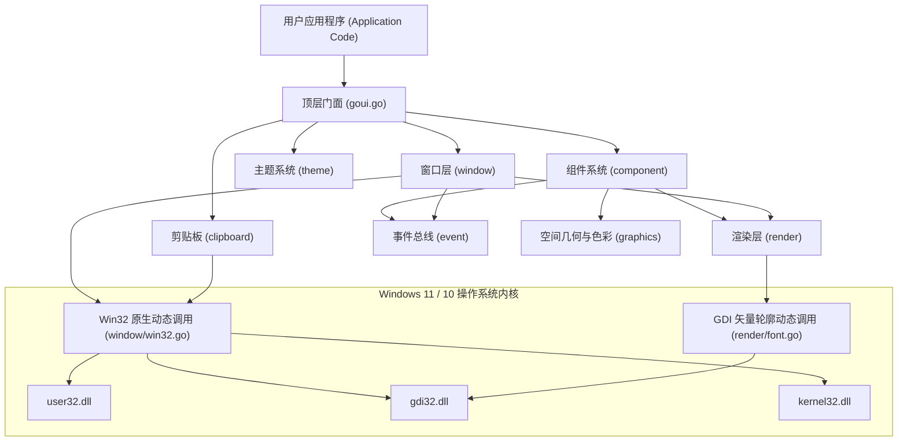
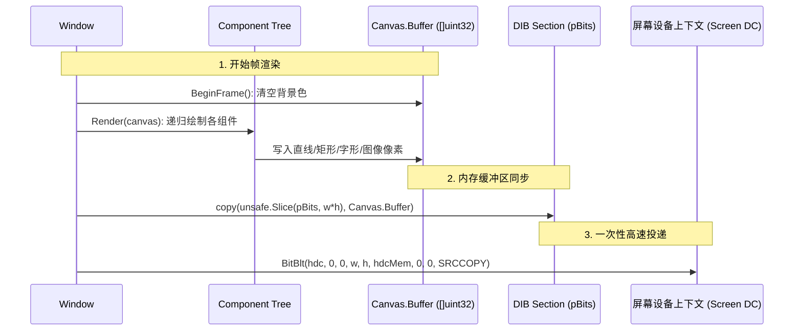

# goui 底层架构与渲染原理 (Architecture)

> 深入剖析 `goui` 无 CGO 依赖、软件双缓冲光栅化、GDI 矢量字形抗锯齿与自闭环事件总线的核心底层技术。

---

## 1. 系统模块拓扑

`goui` 采用分层解耦的模块化拓扑设计，自底向上由操作系统窗口适配层、软件光栅化渲染层、事件总线层、组件容器层和顶层门面构成：



---

## 2. 零 CGO 动态调用机制 (Pure Go)

主流跨平台 GUI 框架往往深度绑定 C++ 或 C 工具链，导致在 Windows 平台配置 MinGW/GCC 极为繁琐，且跨平台交叉编译障碍重重。`goui` 坚持 **100% 纯 Go**：

- **动态链接库绑定**：在 [`window/win32.go`](../window/win32.go) 中使用 `syscall.NewLazyDLL` 按需挂载 Windows 系统核心库：
  ```go
  var (
      modUser32   = syscall.NewLazyDLL("user32.dll")
      modGdi32    = syscall.NewLazyDLL("gdi32.dll")
      modKernel32 = syscall.NewLazyDLL("kernel32.dll")
  )
  ```
- **Windows 回调注入**：利用 `syscall.NewCallback` 将 Go 原生函数导出为 Win32 消息循环回调过程：
  ```go
  LpfnWndProc: syscall.NewCallback(globalWndProc)
  ```
- **窗口映射与句柄查找**：Win32 窗口过程是一个全局 C-Style 过程。`goui` 通过线程安全的全局哈希表 `windowMap map[uintptr]*Window`（配合 `sync.RWMutex`），当系统事件传入时，由 `hwnd` 瞬间查找到 Go 中的对应 [`Window`](../window/window.go) 对象。

---

## 3. 软件双缓冲渲染流水线

原生 Win32 应用极易产生白屏重绘闪烁（Flicker）与画面撕裂。`goui` 采用全内存自研软件光栅化与 DIB Section 投递流水线彻底解决了该问题：



### 3.1 DIB Section 双缓冲创建
在 [`Window.initRenderer`](../window/window.go) 中配置 DIB 位图头：
```go
w.bmi.BmiHeader.BiWidth = width
w.bmi.BmiHeader.BiHeight = -height // 负值表示从上到下扫描线 (Top-Down DIB)
w.bmi.BmiHeader.BiBitCount = 32    // 32 位 ARGB
var pBits unsafe.Pointer
w.hBitmap = CreateDIBSection(hdc, &w.bmi, DIB_RGB_COLORS, &pBits, 0, 0)
w.pBits = (*uint32)(pBits)
```

### 3.2 零拷贝与快速同步
在软件画布完成所有组件绘制后，通过 Go 1.17+ 引入的 `unsafe.Slice` 将系统映射指针切片化，利用内置的高性能汇编版 `copy()` 将像素数据搬运至 DIB 内存，随后调用 Win32 `BitBlt` 一次性拷贝到屏幕 DC。

### 3.3 彻底杜绝重绘闪烁
Win32 默认在窗口尺寸变动或重绘时触发 `WM_ERASEBKGND` 用默认白色画刷清空背景，导致明显的白色闪烁。`goui` 在全局窗口过程中直接拦截该消息：
```go
case WM_ERASEBKGND:
    return 1 // 阻止 Windows 默认背景擦除
```
整个背景清空完全在内存中的 `Canvas.Buffer` 内部执行，用户屏幕上看到的始终是连续、平滑的完整帧。

---

## 4. GDI 矢量字体抗锯齿引擎

为了兼顾跨平台字形保真度与完全受控的图层渲染顺序，`goui` 摒弃了传统的 `TextOutW`（传统做法会越过软件图层直接画在屏幕上，导致 Z-Order 错乱和穿透），采用矢量字形提取方案：

### 4.1 65 级灰度字形提取
在 [`render/font.go`](../render/font.go) 中，通过 GDI 原生 API `GetGlyphOutlineW(..., GGO_GRAY8_BITMAP)`，直接提取单字符的矢量抗锯齿灰度覆盖率蒙版（Coverage Mask）。

### 4.2 线性灰度映射
早期版本使用 $\gamma = 1.45$ 的感知增强查找表，但在深色主题下会把字形边缘过度提亮，产生发虚、发胀的毛边。当前实现保留 256 项查找表以支持后续校准，默认采用线性映射，保持 GDI 覆盖率蒙版的原始灰度：
```go
// render/font.go
for i := 0; i < 256; i++ {
    gammaTable[i] = uint8(i)
}
```

### 4.3 内存级 Alpha 像素混合
字形像素直接混合写入 `Canvas.Buffer`，完全遵循当前的剪裁栈（`PushClip` / `PopClip`）与半透明 Alpha 规则。无论在多层半透明弹窗还是复杂图层中，中英文排版均能呈现清晰平滑的显示效果。

---

## 5. 事件驱动模型与 Z-Order 命中测试

### 5.1 事件分发总线
系统消息在进入 [`Window.handleMessage`](../window/window.go) 后被封装为强类型的 [`event.Event`](../event/event.go) 对象，并提供两套分发通道：
1. **Channel 异步消费通道**：适合工作协程进行低频状态观察。
2. **同步 Handler 回调**：适合 UI 界面即时响应。

### 5.2 反向命中测试与事件冒泡
在 [`Panel.OnEvent`](../component/panel.go) 中，鼠标事件的派发采用**反向遍历（Reverse Iteration）**：
```go
// 从后向前遍历子组件列表（后加入的处于 Z-Index 顶层）
for i := len(p.children) - 1; i >= 0; i-- {
    child := p.children[i]
    if child.IsVisible() && child.IsEnabled() {
        if child.OnEvent(evt) {
            return true // 事件被顶层组件消费，阻断向底层冒泡
        }
    }
}
```
当上层浮动卡片、按钮被点击并返回 `true` 时，事件会立刻中断传递，完美符合现代 GUI 的物理触控直觉。

---

## 6. DPI 感知与高分屏适配

在 Windows 10/11 的 2K、4K 高分屏（如 125%、150%、200% 缩放）环境下，传统 Win32 程序常常出现模糊甚至尺寸错误。

`goui` 内部集成了全面的 Per-Monitor DPI 感知能力：
- 启动时自动调用 `SetProcessDpiAwarenessContext(DPI_AWARENESS_CONTEXT_PER_MONITOR_AWARE_V2)`。
- 创建窗口时调用 `AdjustWindowRectExForDpi` 保证客户区像素精准。
- 监听 `WM_DPICHANGED` 系统广播，在跨显示器拖拽时自动调整物理像素尺寸并重新计算布局：
  ```go
  case WM_DPICHANGED:
      newDpi := uint32(LOWORD(wParam))
      w.dpi = newDpi
      suggestedRect := (*RECT)(unsafe.Pointer(lParam))
      SetWindowPos(hwnd, 0, suggestedRect.Left, suggestedRect.Top, ...)
      w.renderRoot()
  ```
- 提供 [`goui.GetSystemScale()`](../goui.go) 与 [`win.GetScale()`](../window/window.go) 供应用层进行动态尺寸适配。
